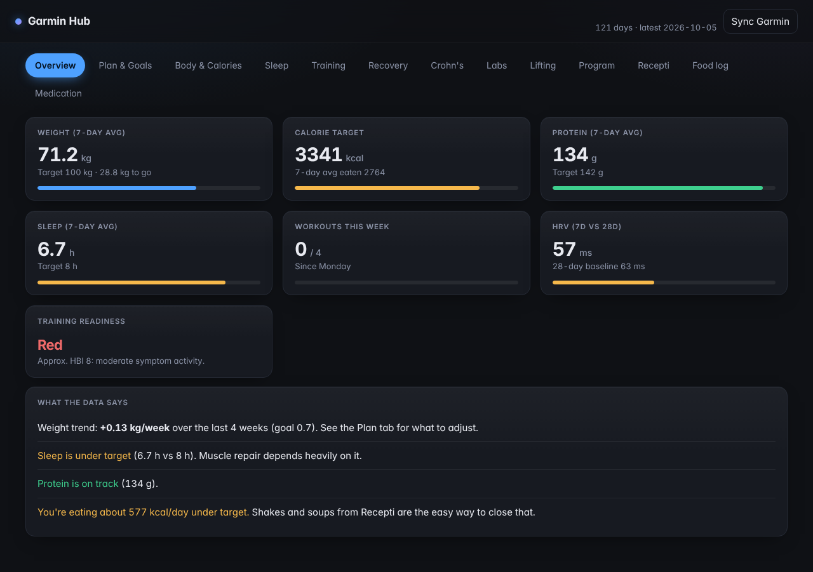

# Garmin Hub

A personal health and training dashboard that runs entirely on your own computer. It pulls your data from Garmin Connect (built around a Fenix 7, but any Garmin that syncs to Garmin Connect works) and combines it with things Garmin doesn't track: food, lifting sets, symptoms and lab results.

Flask + SQLite + vanilla JS + Chart.js. No accounts, no cloud, no tracking. Everything is stored in a single local file, `hub.db`. It also works from your phone (see [Use it on your phone](#use-it-on-your-phone)).



## Features

| Tab | What it does |
|---|---|
| **Overview** | Today at a glance: steps, calories, sleep, resting HR, HRV, Body Battery, weight trend, goals. |
| **Plan & Goals** | Lean-bulk planner: target weight, weekly pace, calorie and protein targets, projected finish date. |
| **Body & Calories** | Weight, body composition and calorie balance (Garmin burn vs. what you log). |
| **Sleep** | Sleep stages and score with a 7-day average. |
| **Training** | Weekly sessions and load. Click any workout for a **GPS map** (coloured by pace, heart rate or elevation), HR / pace / elevation charts linked to the map, km splits and time in HR zones. |
| **Recovery** | HRV and resting-HR trends against your own 28-day baseline. |
| **Crohn's** | Daily symptom log, an approximate Harvey-Bradshaw index, an experimental flare early-warning from Garmin signals, and a personal IBD file. |
| **Labs** | Lab tracker (CRP, calprotectin, ferritin, B12, vitamin D and more) with reference ranges, trends, and **PDF/photo/text upload** that reads Croatian and English lab reports. |
| **Lifting** | Set-by-set logging with double progression, hard-set volume per muscle, estimated 1RM, joint-pain log and exercise swaps. |
| **Program** | 3- or 4-day hypertrophy programmes with a green / yellow / red readiness check that trims or skips sessions. |
| **Recepti** | Croatian recipes with macros and gluten/lactose tags; one click adds them to your day. |
| **Food log** | Meal log with reaction ratings to spot trigger foods, plus **meal photo estimates**, **saved meals** for one-tap logging, a **nutrition-label scan**, and quick **caffeine and water** counters. |
| **Medication** | Medication list with general notes on effects on training, sleep and recovery, plus an **infusion tracker** (next due date, dose log, reminder on Overview). |
| **Insights** | Weekly review (last 7 days vs the 7 before), a "what moves together" comparison of your own days (sleep, HRV, stress, caffeine, training and symptoms), how you look around each infusion, and automatic sync and backup. |
| **Report** | A printable health summary for a doctor's visit, in **English or Croatian**: symptoms, approximate HBI, labs, medication, trends, food reactions and a box for your questions. Print it or save it as a PDF. |

## Requirements

- Python 3.10+ (developed on 3.14)
- A Garmin Connect account
- A browser with internet access (Chart.js, the map library and map tiles load from CDNs)
- Optional, for scanned lab reports or photos: [Tesseract OCR](https://github.com/tesseract-ocr/tesseract) plus `pip install pytesseract pdf2image`. Text PDFs and pasted text work without it.

## Quick start

### Windows

1. Double-click `start.bat`. It creates a virtual environment, installs the packages and opens http://localhost:5055.
2. Preview with fake data first: `.venv\Scripts\python demo.py`, then refresh the page. Delete `hub.db` before your first real sync to remove it.
3. Sign in to Garmin once from a terminal in the project folder:

   ```
   .venv\Scripts\python sync.py --days 400
   ```

   It asks for your Garmin email and password (and an MFA code if enabled) and saves the login tokens in `~/.garminconnect`. After that, the **Sync Garmin** button in the page pulls the last 7 days, and activity details can be downloaded on demand.

### macOS / Linux

```bash
python3 -m venv .venv
.venv/bin/pip install -r requirements.txt
.venv/bin/python demo.py          # optional: fake data preview
.venv/bin/python sync.py --days 400
.venv/bin/python app.py           # open http://localhost:5055
```

## Use it on your phone

The layout is responsive: on a phone the tabs become one swipeable row, tables scroll inside their cards, and the workout detail opens full-screen.

To reach the hub from your phone when you're away from home, use [Tailscale](https://tailscale.com) (free for personal use). It creates a private network between your own devices, so the hub is never exposed to the open internet.

1. Install Tailscale on the computer that runs the hub and on your phone, and sign in to the same account on both.
2. Start the hub (`start.bat`, or `python app.py`).
3. On the computer, run once (a terminal opened as administrator can help the first time):

   ```
   tailscale serve --bg 5055
   ```

   If it says Serve is not enabled, open the link it prints, enable it, and run the command again. It then prints an address like `https://your-pc.your-tailnet.ts.net`. The setting is remembered across reboots.
4. On your phone, turn Tailscale on and open that address. On iPhone you can use Share → **Add to Home Screen** for an app-style icon.

The computer has to be on, awake and running the hub for the page to load. The hub itself keeps listening on `127.0.0.1` only; Tailscale forwards to it privately.

> Do not use port forwarding or Tailscale Funnel for this. The hub has no login, so it must only be reachable from your own devices.

## Meal photos (optional)

The Food log tab can estimate calories and macros from a photo of your plate. It uses a vision model that runs **on your own computer**, so the photo never leaves it.

1. Install [Ollama](https://ollama.com) (or [LM Studio](https://lmstudio.ai)) and download a vision model once, for example `ollama pull qwen2.5vl:7b`.
2. In the Food log tab, open **Model settings**, choose the engine and the model.
3. Take or choose a photo, optionally add a note ("chicken, rice and salad"), and press **Estimate**. Check and correct the items, then save.

The hub starts the engine when needed and the model is unloaded after a few idle minutes, which frees your GPU. Estimates from a photo are rough (expect 20-30% error or more), so treat them as a starting point.

If the engine crashes on image input, it is usually the GPU backend: on some AMD cards Vulkan fails while decoding images. For Ollama, set the environment variable `OLLAMA_VULKAN=0` (the hub does this when it starts Ollama itself) and restart Ollama.

## Saved meals and label scan

After a photo estimate, correct the numbers once and press **Save meal**. It appears as a chip above the photo button; tapping it loads the items again and changing the grams rescales the macros. **Scan a label** reads the nutrition table on a package (per 100 g, converted to what you ate), which is much more accurate than estimating a plate.

## Report for your doctor

The **Report** tab builds a one-to-three page summary of the last 3, 6 or 12 months. Switch the language between English and Croatian, add your name and your questions, then press **Print / Save as PDF**. The text of lab names, headings and explanations is translated; free text you typed (medication history, scope reports) is shown as you wrote it. It is a summary of self-tracked data, not a medical record.

## Automatic sync and backup

While the hub is open it syncs the last 3 days from Garmin every few hours (only after you have signed in once with `sync.py`) and writes a daily copy of `hub.db`, keeping the newest 14. Both are controlled on the Insights tab. Point the backup folder at a cloud-synced directory (OneDrive, Google Drive, Dropbox) to get an off-site copy.

## How things work

- **Garmin sync** (`sync.py`) uses the unofficial [`garminconnect`](https://github.com/cyberjunky/python-garminconnect) library. Garmin can change things without notice; if sync breaks, run `pip install -U garminconnect`.
- **Calories eaten** are not known to Garmin. Log them in the Body tab, add a recipe from the Recepti tab, or link MyFitnessPal in Garmin Connect.
- **Activity details** (`activity_detail.py`) are downloaded the first time you click a workout and cached in `hub.db`. The raw Garmin response is also saved in `activity_cache/`.
- **Lab upload** (`labparse.py`) runs locally: text is extracted from the PDF, test names are matched with Croatian/English aliases, units are converted, and you review everything in an editable table before anything is saved. Original files are kept in `lab_uploads/`.
- **Training logic** lives in `static/knowledge.js` (exercise library, programmes, volume targets, rules) and `static/lift.js`.

## Project layout

```
app.py              Flask app and core API
extra_routes.py     Symptoms, labs, sets, pain log endpoints
activity_detail.py  Per-activity GPS / series / splits / zones
meal_vision.py      Meal photo / label -> macros, saved meals (Ollama / LM Studio)
autotasks.py        Background Garmin sync and daily database backup
labparse.py         Lab report reader
sync.py             Garmin Connect sync
db.py               SQLite schema and default settings
demo.py             Fake data generator
recipes.json        Recipe data (built by recipes_build.py)
static/             index.html, style.css and the JS for each tab
```

## Privacy

Your data never leaves your computer except for the requests to Garmin Connect and to the CDNs and map tiles. `hub.db`, `lab_uploads/`, `activity_cache/` and the Garmin tokens contain personal health data. They are listed in `.gitignore`; do not commit them.

The server binds to `127.0.0.1` only. Do not expose it to the internet: there is no authentication.

## Disclaimer

This is a personal project, not a medical device. The Crohn's, lab, medication and training content is general reference information and **not medical advice**. The flare early-warning is experimental, the Harvey-Bradshaw score is an approximation, and lab reference ranges are generic and vary between laboratories. Talk to your doctor or IBD team about anything that matters. Not affiliated with or endorsed by Garmin.

## License

Add a license of your choice (for example MIT) before publishing.
